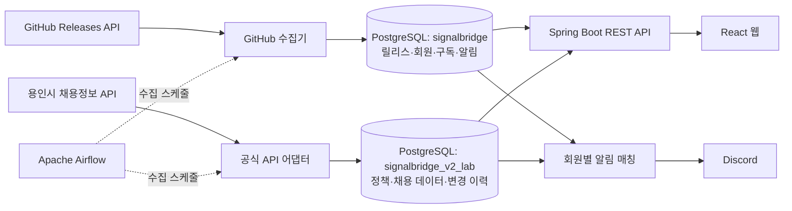

# SignalBridge

**2030 청년정책·채용공고 통합 플랫폼 | 개발자용 GitHub Releases 모니터링**

[](https://github.com/hanmj97/SignalBridge/actions/workflows/signalbridge-ci.yml)

> **상태: 로컬 포트폴리오 MVP (외부 공개 서비스 아님).** 기능 검증은 로컬 Docker 환경 기준이며, 공식 API 이용 승인·보안·운영 검증이 완료된 상용 서비스가 아닙니다. GitHub 저장소 공개와 웹서비스 배포는 별개입니다.

## 프로젝트 소개

다른 기관·서비스에 흩어진 데이터를 Python으로 수집·정규화하고 PostgreSQL에 변경 이력을 보존한 뒤, Spring Boot REST API와 React UI에서 조회하도록 만든 데이터 중심 풀스택 프로젝트입니다. Airflow가 주기 수집을 관리하고, 회원별 관심 조건에 따라 알림 이벤트를 매칭합니다.

**서비스 범위는 구분되어 있습니다.**

- **일반 사용자:** (1) 20~30대를 위한 청년 지원금·취업지원 등 청년정책 (2) 채용공고. 일반 중소기업 지원사업이나 시험·합격자 발표 등 무관한 데이터를 섞지 않습니다.
- **Engineering:** 개발자가 등록한 공개 GitHub 저장소의 릴리스·변경 이력 모니터링 및 Discord 알림. 일반 사용자용 정책·채용 카탈로그와 분리된 기능입니다.

## 구현 및 검증 현황

| 영역 | 구현 내용 | 현재 검증 범위 |
| --- | --- | --- |
| 채용정보 | 용인시 공식 API의 `채용정보`만 필터링하여 수집 | 로컬 실제 API 조회·LAB DB 적재·재수집 중복 방지·웹 조회 확인(개발자 수동 검증) |
| 청년정책 | 온통청년 어댑터와 청년정책 UI | 승인 대기. 모의 데이터로 로직 검증하며 실데이터라고 표시하지 않음 |
| 민간 채용 | 사람인 어댑터 및 제공처 레지스트리 | 사람인·잡코리아 키/이용 승인 대기, 원티드·자소설닷컴 공식 이용 경로 확인 필요 |
| Engineering | GitHub Releases 수집·사용자별 저장소 등록·변경 감지 | 실제 SignalBridge 테스트 릴리스 수집 및 Discord 알림 로컬 확인 |
| Airflow | GitHub 주기 수집, 용인시 채용정보 일간 수집, 별도 관심 알림 DAG | 용인시 수동 DAG 실행·일일 스케줄 활성화 확인(개발자 로컬 검증); 연속 자동 실행 결과는 별도 추적 |
| 회원 | Spring Security 세션, 이메일 인증·비밀번호 재설정·마이페이지 | 기능 구현 및 테스트; 인터넷 공개 전 인증/세션 보안 추가 점검 필요 |
| 정책·채용 관심 알림 | 규칙 등록/변경/삭제, 이벤트 매칭·Discord 발송 구조 | 비데모·검증된 원문 링크(`ARTICLE`)만 대상으로 필터링; 용인시 `DATASET` 링크는 Discord 전송에서 제외 |
| 품질 | Python unittest, JUnit, TypeScript 빌드, 비밀정보 검사 | GitHub Actions CI 성공 이력. CI 성공은 운영 통합 테스트를 의미하지 않음 |
| 복구 | PostgreSQL custom-format 백업 스크립트와 복구 훈련 절차 | 백업·복원 가이드 준비. 실제 격리 복원 성공 증적은 최종 확인 전까지 완료로 표시하지 않음 |

## 기술 스택

| 분야 | 기술 |
| --- | --- |
| Frontend | React, TypeScript, Vite |
| Backend | Java 21, Spring Boot 3, Spring Security, Spring JDBC |
| Database | PostgreSQL 17, SQL, JSONB |
| 수집·처리 | Python, Requests, psycopg, GitHub Releases API, 공식 공공데이터 API |
| 오케스트레이션 | Apache Airflow |
| 인프라·검증 | Docker Compose, GitHub Actions, unittest, JUnit |
| 알림·인증 | Discord Webhook, Resend 이메일 |

## 시스템 아키텍처



- 두 DB는 로컬에서 **같은 PostgreSQL 서버 안에 있는 별도 데이터베이스**입니다. 메인 회원 DB에 채용 데이터를 섞어 저장하지 않습니다.
- 정책·채용 알림은 원문 링크가 검증된 데이터에만 발송합니다. 용인시 API의 제공처 페이지를 개별 지원 링크로 오인하지 않습니다.
- 자세한 설명: [아키텍처·데이터 흐름·운영 경계](docs/architecture.md)

## 데이터 정합성·운영 설계

- `sources`: 제공처/저장소 및 수집 상태, ETag 관리
- `records`: 제공처 + 외부 ID의 유일성, 현재 상태·콘텐츠 해시
- `record_versions`: NEW/UPDATED 스냅샷, 변경 이력·버전 추적
- `ingestion_runs`: SUCCESS/FAILED/NOT_MODIFIED 등 수집 결과 기록
- `opportunity_details`: 공고 유형·기관·기간·링크 유형 등 정규화 속성
- `opportunity_alert_rules` / `opportunity_alert_events`: 회원 DB의 개인별 관심 조건·이벤트; GitHub 알림 테이블과 별도 운영

수집기는 UPSERT, 유일성 제약, 행 잠금, 트랜잭션으로 중복 적재와 동시 변경 충돌을 줄입니다. 실패 시 수집 기록을 남기고, 인위적으로 확인되지 않은 나이·근무 지역·개별 URL을 생성하지 않습니다.

### 성능 튜닝 실험 (실제 서비스 데이터 아님)

별도 **15만 건 합성 데이터**에서 9회 측정한 중앙값(ms)을 비교했습니다.

| 검색 조건 | OR | UNION | 관찰 |
| --- | ---: | ---: | --- |
| 희소 검색어 | 234.813 | 7.790 | UNION 유리 |
| 중간 빈도 | 132.423 | 19.197 | UNION 유리 |
| 소스명 | 215.590 | 42.018 | UNION 유리 |
| 흔한 검색어 | **44.919** | 242.807 | **OR 유리** |

특정 쿼리 형태를 무조건 권장하지 않고 데이터 분포·실행계획에 따라 판단한 실험입니다. 실제 서비스 응답시간이나 SLA 수치는 아닙니다.

## 실행 방법 (로컬 Windows / PowerShell)

Docker Desktop과 Docker Compose, Python 3가 필요합니다. Java 21·Node.js는 컨테이너 밖에서 직접 빌드할 때 사용합니다. 실데이터를 수집하려면 **승인된 개인 API 키**가 필요합니다.

```powershell
# 저장소 복제 (이미 로컬 폴더가 있다면 중복 복제하지 않음)
git clone https://github.com/hanmj97/SignalBridge.git
Set-Location SignalBridge

# 로컬 개인 설정 파일 생성 (기존 .env가 있다면 덮어쓰지 않음)
if (-not (Test-Path .env)) {
    Copy-Item .env.example .env
}

# 실제 키와 비밀번호는 .env에만 설정하고 GitHub에 올리지 않음
# 민감정보와 추적 파일 점검
py -3 .\tools\phase15_preflight.py
```

단계별 Compose 오버레이가 존재하므로 **전체 실행 전 설정과 적용 순서를 확인**해 주세요. 기존 환경을 다시 실행할 때에는 이전에 사용한 전체 `-f` 순서를 유지하며, `docker compose ... config --quiet`로 검사한 후 `up -d`를 사용합니다. DB 데이터를 유지해야 하므로 `down -v`를 실행하지 않습니다.

- [로컬 운영·백업 가이드](docs/PHASE15-OPERATIONS.md)
- [용인시 채용정보 수집·노출 범위](docs/V2-7B-YONGIN-JOBS-ONLY.md)
- [Engineering 회원별 릴리스 알림](docs/ENGINEERING-V2-12-ALERTS.md)
- [포트폴리오 릴리스 노트 초안](docs/RELEASE-NOTES-v0.2.0.md)

### 테스트

```powershell
# 프로젝트 루트에서만 실행
# Python 수집·Airflow·비밀정보 사전점검 (실제 외부 전송 없음)
.\scripts\check-phase15.ps1

# 용인시 채용정보 필터의 오프라인 회귀 테스트
.\scripts\check-v2-7b.ps1

# 회원별 관심 알림 API 접근/매칭 검사 (실제 Discord 발송 없음)
.\scripts\check-v2-3.ps1
```

[GitHub Actions CI 실행 이력](https://github.com/hanmj97/SignalBridge/actions) — 단위·빌드·정적 검사와 실제 로컬 API/DB 통합 검증은 구분합니다.

## 알려진 제한 및 다음 작업

- 온통청년·사람인·잡코리아는 공식 승인·권한·응답 구조 확인 이후에만 실데이터로 전환합니다.
- 용인시 공고는 연령/근무지 자격을 추정하지 않으며, 개별 지원 URL 미제공으로 `DATASET` 링크만 사용합니다. 최근 30일·최대 3페이지×20건의 일간 수집은 전체 공고 수집을 보장하지 않습니다.
- 정책·채용 Discord 알림은 검증된 `ARTICLE` 링크에만 적용됩니다. 용인시 `DATASET` 데이터는 의도적으로 발송 대상에서 제외됩니다.
- 로컬 서버가 꺼져 있으면 Airflow 일정은 실행되지 않으며 `catchup=False`로 중단 일정을 모두 보충하지 않습니다.
- 외부 공개 전 HTTPS, 세션 전면 무효화, 요청 제한, 인증·발송 도메인, 백업 복원 성공 증적, 개인정보 처리 정책 등의 검증이 필요합니다.
- UI 캡처와 실제 복원 테스트 증적은 검증 후 포트폴리오에 추가합니다. 미완료 검증을 완료로 표시하지 않습니다.

## 보안·라이선스

`.env`, 개인 API 키, 회원 데이터가 들어 있는 DB 덤프, Discord Webhook/암호화 키는 Git에 커밋하지 않습니다. 공개 데이터의 원문 출처·허용 조건을 확인하고, 임의 크롤링 또는 무단 재배포를 하지 않습니다. 별도 LICENSE 파일이 없으면 오픈소스 라이선스를 부여한 것으로 간주하지 않습니다.
