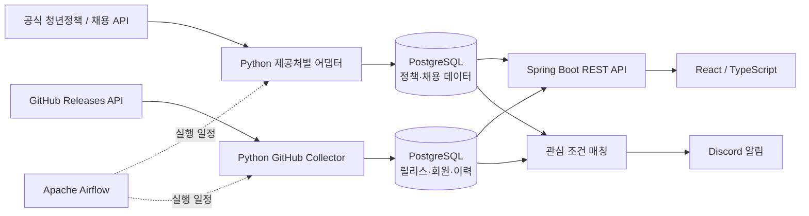

# SignalBridge

**2030 청년 지원정책 · 채용공고 통합 플랫폼 + 개발자를 위한 GitHub Releases 모니터링**

[](https://github.com/hanmj97/SignalBridge/actions/workflows/signalbridge-ci.yml)

> **프로젝트 상태:** 로컬 개발 및 기능 검증 중인 MVP입니다. GitHub 저장소가 공개되어 있어도 웹서비스가 외부 사용자에게 배포된 것은 아닙니다. 공식 API 연동과 운영 보안 검증은 제공처별로 단계적으로 진행하고 있습니다.

## 프로젝트 소개

SignalBridge는 서로 다른 출처에 분산된 정보를 정규화하여 수집하고, **검색·변경 이력·개인 맞춤 알림**으로 연결하는 데이터 기반 웹 플랫폼입니다.

일반 사용자에게 제공하는 정보는 다음 **두 가지 범위**로 한정합니다.

1. **2030 청년 지원정책** — 청년 지원금, 취업 지원, 청년 일자리 프로그램 등
2. **채용공고** — 신입·경력·인턴·공채 등 기업 및 기관의 채용 정보

별도의 **Engineering** 영역에서는 개발자가 공개 GitHub 저장소의 릴리스와 변경 내역을 추적하도록 지원합니다. 이는 일반 사용자에게 제공하는 정책·채용 데이터와 분리된 기능입니다.

## 주요 기능

### 청년정책 · 채용

- 청년 지원정책과 채용공고를 **두 개의 카테고리**로 구분해 검색
- 검색어 및 지역 등의 조건에 따른 목록·상세 조회
- 출처 표시, 신청·모집기간, 변경 이력 확인
- 회원별 관심 조건 관리 및 Discord 알림 구조
- 공식 API 수집 시 중복 방지와 내용 변경에 따른 버전 기록

### Engineering

- 공개 GitHub Releases API를 이용한 릴리스 데이터 수집
- VS Code, Docker Compose, Grafana 등 공개 저장소 모니터링
- 릴리스 목록·변경 이력·수집 상태 대시보드
- ETag, 콘텐츠 해시, PostgreSQL 버전 테이블을 이용한 변경 감지
- 사용자별 공개 GitHub 저장소 URL 등록·연결 해제 기능 개발 및 통합 검증
- 회원별 관심 릴리스 규칙과 Discord 알림 연동

### 계정 및 운영

- Spring Security 기반 계정 인증 및 세션 관리
- 이메일 인증, 비밀번호 복구, 마이페이지 기능
- Airflow DAG를 이용한 수집·알림 작업 분리
- 수집 실행 이력 및 데이터 상태 확인
- Python / Java / TypeScript 테스트와 GitHub Actions CI

## 데이터 제공처 연동 상태

| 제공처 | 목적 | 현재 상태 |
| --- | --- | --- |
| **온통청년** | 2030 청년정책 | API 승인 대기, 가상 응답 기반 수집 검증 구현 |
| **용인시 채용 및 시험정보** | 공식 채용정보 | API 인증키 발급 완료, 채용정보 조건 기반 실제 수집 기능 개발 |
| **사람인** | 민간 채용공고 | 공식 API 어댑터 및 오프라인 테스트 구현, API 키 발급 대기 |
| **잡코리아** | 민간 채용공고 | 공식 API 이용신청·승인 대기 |
| **원티드·자소설닷컴** | 민간 채용공고 | 공식 API 또는 제휴 가능 여부 확인 필요 |
| **GitHub Releases** | Engineering | 공개 릴리스 수집·변경 이력 추적 구현 |

> API 제공처의 인증·이용 조건·재표시 권한을 검증하기 전에는 실제 데이터를 임의로 수집하거나 게시하지 않습니다. 개발용 가상 데이터는 실데이터와 구분합니다. 용인시의 채용정보 외 시험 안내·합격자 발표 등은 서비스 대상에서 제외합니다.

## 기술 스택

| 구분 | 기술 |
| --- | --- |
| Frontend | React, TypeScript, Vite |
| Backend | Java 21, Spring Boot 3, Spring Security, Spring JDBC |
| Database | PostgreSQL 17, SQL, JSONB |
| Data ingestion | Python, Requests, psycopg, 공식 REST API |
| Workflow | Apache Airflow |
| Infrastructure | Docker, Docker Compose |
| Notifications | Discord Webhook, Resend 기반 이메일 |
| Quality | JUnit, Python unittest, GitHub Actions |

## 시스템 아키텍처



### 데이터 일관성 설계

- `sources`: 수집 제공처 및 저장소 메타데이터
- `records`: 출처별 현재 데이터와 안정적인 외부 ID
- `record_versions`: 신규 등록·내용 수정 시 버전 이력
- `ingestion_runs`: 수집 결과 및 실패 내역
- `opportunity_details`: 정책·채용 공고의 정규화 속성
- 사용자 인증·구독 정보는 별도 테이블로 관리

일부 수집·조회 경로는 개발용 분리 DB(`signalbridge_v2_lab`)를 사용합니다. 이는 정식 운영 데이터와 동일한 배포 구성이 아니라 테스트 환경을 위한 구분입니다.

## 프로젝트 구조

```text
SignalBridge/
├── airflow/           # 수집·알림 DAG 및 테스트
├── backend/           # Spring Boot REST API, 인증, 회원별 조회
├── collector/         # Python 수집기 및 API 제공처별 어댑터
├── db/                # PostgreSQL 초기화·마이그레이션·SQL 테스트
├── frontend/          # React·TypeScript 웹 UI
├── perf-lab/          # SQL 성능 실험
├── scripts/           # 단계별 적용·검증 PowerShell 스크립트
├── tools/             # 배포 전 보안/소스 사전 검사
├── docs/              # 설계·검증·마이그레이션 안내
└── .github/workflows/ # GitHub Actions CI
```

## 로컬 개발 및 검증

**필요한 환경:** Windows/PowerShell 또는 호환 셸, Docker Desktop / Docker Compose, Python 3, Java 21(개별 실행 시), Node.js(개별 실행 시).

```powershell
# 저장소 내려받기
# 기존 로컬 개발 폴더가 있다면 중복 clone하지 않습니다.
git clone https://github.com/hanmj97/SignalBridge.git
Set-Location SignalBridge

# 공개 예시 환경설정 복사 — 실제 키/비밀번호는 로컬에서만 설정
Copy-Item '.env.example' '.env'

# 민감정보 및 추적 대상 파일 사전 검사
py -3 .\tools\phase15_preflight.py
```

> `.env.example`은 기본적인 환경변수 예시입니다. 실제 실행에는 사용하려는 Docker Compose 오버레이 및 기능에 따라 추가 환경변수가 필요합니다. **`.env` 파일이나 API 키를 Git에 올리지 마세요.** 프로젝트는 여러 단계로 발전했으므로 일괄 실행보다 `docs/`의 단계별 적용·검증 문서를 참고해 주세요.

관련 문서:

- [아키텍처](docs/architecture.md)
- [테스트 계획](docs/TEST-PLAN.md)
- [운영 및 백업](docs/PHASE15-OPERATIONS.md)
- [V2 청년정책·채용 연동](docs/V2-7B-YONGIN-JOBS-ONLY.md)
- [Engineering 저장소 관리](docs/ENGINEERING-V2-9-APPLY.md)

## 테스트 및 CI

GitHub Actions에서 다음 항목을 검사합니다.

- 추적 파일·민감정보 사전 검사 및 Python 도구 자체 테스트
- Python 수집기 / Airflow DAG 단위 테스트
- Maven / JUnit 기반 Spring Boot 테스트
- TypeScript 타입 검사 및 Vite 빌드

[GitHub Actions 실행 결과 보기](https://github.com/hanmj97/SignalBridge/actions)

> CI 통과는 정적·단위 검증 결과를 의미합니다. 실제 외부 API, DB 마이그레이션, Docker 통합 구동 및 보안 설정은 별도로 검증해야 합니다.

## 앞으로의 작업

- 승인받은 공식 **청년정책·민간 채용 API** 실데이터 연동 확대
- 사용자별 GitHub 저장소 관리와 릴리스/변경 이력 정렬 통합 검증
- 상세 검색·필터, 신청 마감일 및 알림 품질 개선
- 외부 공개 전에 인증·비밀정보·개인정보·백업 복구·운영 안정성 검증
- 기능이 안정화된 후 실제 서비스 화면 캡처와 첫 GitHub Release 추가

## 보안 및 라이선스

- 환경변수, DB 비밀번호, API 키, Discord Webhook은 로컬 비밀정보로 관리합니다.
- 공개 저장소라는 사실은 공개 웹서비스 배포나 외부 데이터 이용허락을 의미하지 않습니다.
- 외부 서비스의 이용약관과 원문 출처 표시 조건을 존중합니다.
- 별도 `LICENSE` 파일이 추가되기 전까지 이 저장소에 오픈소스 라이선스가 부여된 것으로 간주하지 마세요.
