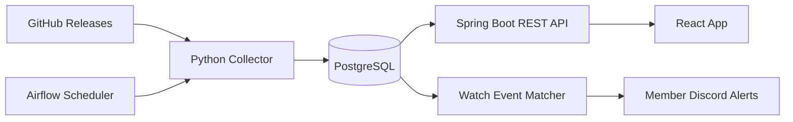

# SignalBridge — Release Change Tracking Platform

> **상태: 로컬 MVP / 개발 진행 중. 외부 공개 및 운영 보안 검토 미완료.**

Python으로 공개 GitHub 릴리스 정보를 수집하고, PostgreSQL에 버전별 변경 이력을 관리하며, React/Spring Boot 웹서비스와 관심 키워드 알림을 제공하는 개인 풀스택 데이터 프로젝트입니다.

## 핵심 기능

- **수집**: GitHub Releases API + ETag 기반 변경 조회; 일정 주기의 Airflow DAG 실행.
- **데이터 일관성**: 소스별 트랜잭션, 콘텐츠 해시, 중복 적재 방지, `record_versions` 이력 관리.
- **조회**: Spring Boot REST API + 검색/필터/페이징 + React UI.
- **운영**: 소스별 최근 수집 결과 및 DB에 기록된 `ingestion_runs` 모니터링.
- **사용자**: 세션 기반 회원가입·로그인, Resend 이메일 인증·비밀번호 복구, 마이페이지·계정 관리.
- **알림**: 관심 규칙과 릴리스 이력을 매칭해 회원별 Discord 채널로 전송.

## 기술 스택

| 영역 | 기술 |
| --- | --- |
| Data Ingestion | Python, Requests, GitHub Releases API |
| Orchestration | Apache Airflow |
| Database | PostgreSQL 17, SQL, EXPLAIN ANALYZE |
| API | Java 21, Spring Boot 3, Spring JDBC, Spring Security |
| Frontend | React, TypeScript, Vite |
| Ops | Docker Compose, DBeaver, GitHub Actions CI |

## 데이터 흐름



## SQL 성능 실험 (별도 synthetic 데이터 150,000건)

| 검색 유형 | OR 중앙값 | UNION 중앙값 | 주요 관찰 |
| --- | ---: | ---: | --- |
| 희소 검색어 | 234.813ms | 7.790ms | GIN 및 후보 선택 효과 |
| 중간 빈도 | 132.423ms | 19.197ms | UNION 유리 |
| 소스명 | 215.590ms | 42.018ms | UNION 유리 |
| 흔한 검색어 | **44.919ms** | 242.807ms | **OR가 유리** |

*9회 반복 측정 중 실행 시간 중앙값. 별도 성능 테스트 DB에서의 수치로 실제 운영 성능을 대표하지 않습니다. OR/UNION은 무조건 교체하지 않고 선택적으로 검증했습니다.*

## 품질 보증

- Python 단위 테스트와 Java Maven 테스트, React TypeScript 빌드를 GitHub Actions로 검증.
- `.env`, DB 덤프, 인증 토큰, 암호화 키는 Git에서 제외하고 정적 사전점검 수행.
- PostgreSQL custom-format 백업 생성 및 archive 무결성 검사.

## 실행 방법 (로컬 개발)

필요한 도구: Docker Desktop, Docker Compose, Python 3, Git. 비밀정보는 `.env.example`을 바탕으로 개인 `.env`에 설정하며, **`.env`는 업로드하지 않습니다.**

프로젝트의 Docker Compose 파일을 순서대로 조합해 실행합니다. 전체 절차는 `README-APPLY.md` 및 각 단계 문서를 참고하세요.

```powershell
# 로컬 비밀정보와 추적 파일 사전 점검
py -3 .\tools\phase15_preflight.py

# 데이터 수집 및 Airflow 테스트
.\scripts\check-phase15.ps1
```

## 보안 및 제한 사항

현재 localhost 기반 검증용으로, 외부 공개 전 다음 사항이 필수입니다: HTTPS, secure session cookie, 다른 브라우저 세션 철회, IP/계정별 rate limit, Resend 발송 도메인 인증, 개인정보 보존 정책, 복원 훈련 및 통합 테스트. 로컬 Airflow standalone과 PostgreSQL 포트는 외부에 노출하면 안 됩니다.

## 향후 계획

- 운영용 배포 아키텍처 및 알림 전송 신뢰성 향상
- 공식 공공데이터 소스 어댑터 확장
- 모니터링/부하 테스트 및 장애 복원 자동화
