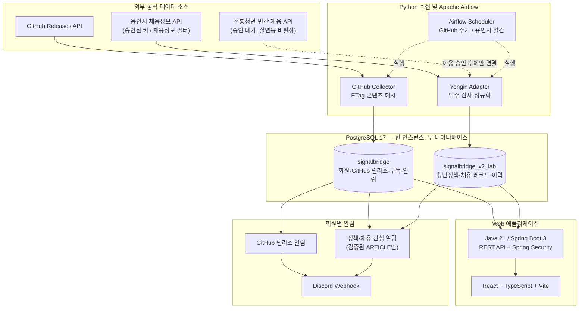
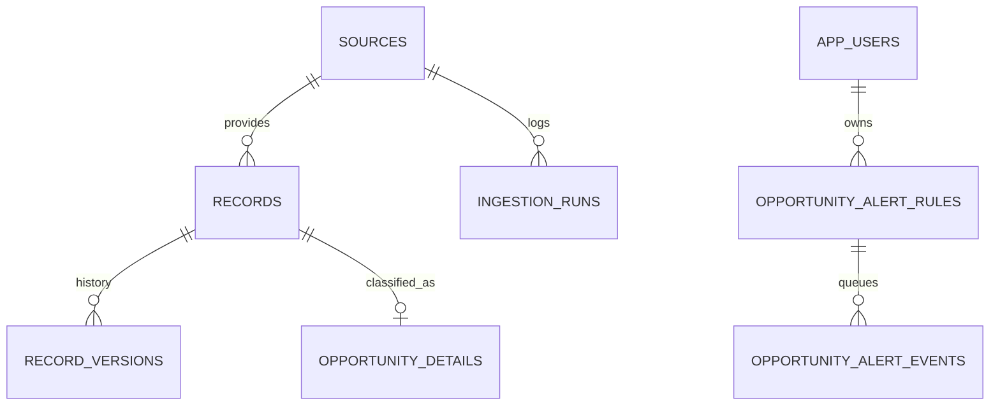

# SignalBridge — 시스템 아키텍처 (포트폴리오 로컬 MVP)

> **문서 범위:** 현재 구현된 로컬 구조와 아직 검증/승인이 필요한 운영 범위를 구분합니다. 외부 공개 서비스 아키텍처가 아닙니다.

## 1. 서비스 영역

- **일반 사용자:** 2030 청년 지원정책, 채용공고. 두 카테고리만 제공하며 시험/합격자 발표 및 일반 중소기업 지원사업은 제외합니다.
- **Engineering:** 개인이 등록한 공개 GitHub 저장소의 릴리스, 버전 이력, 관심 알림.
- **인증:** Spring Security 기반 회원 로그인/세션, Resend 이메일 인증·복구, Discord 웹훅 연결·암호화 저장.

## 2. 실행 구성

**주의:** `signalbridge`와 `signalbridge_v2_lab`은 PostgreSQL 컨테이너 두 개가 아니라 **동일 PostgreSQL 서버 안에 있는 별개 데이터베이스**입니다. Airflow 메타데이터는 독립된 로컬 볼륨의 SQLite(standalone)로 관리합니다.

## 3. 레코드 모델 및 정합성

- `sources`: `source_key`, 제공처 식별/리소스, ETag, 최종 확인 시각
- `records`: `UNIQUE(source_id, external_id)`, 콘텐츠 해시, 현재 버전
- `record_versions`: `UNIQUE(record_id, version)`, NEW/UPDATED 기록과 이전 스냅샷
- `ingestion_runs`: 상태, 시작/종료 시각, 수집 및 변경 건수
- `opportunity_details`: 공고 유형, 카테고리, 신청 기간, 링크 신뢰도(ARTICLE/DATASET), 데모 여부
- `app_users` / `opportunity_alert_rules` / `opportunity_alert_events`: 메인 DB의 계정·구독·알림. 외부 LAB DB의 record/version ID는 애플리케이션 수준으로 참조하며 **서로 다른 DB 사이에는 FK가 없음**

**변경 반영 절차**

1. 외부 응답의 유형·ID·필드·일정을 검증하고 출처 ID로 정규화.
2. 동일 키가 없다면 레코드와 버전 1(NEW)을 저장.
3. 기존 키는 해시를 비교하여 동일하면 UNCHANGED 처리하고, 변경이면 행 잠금 후 버전 증가( UPDATED ).
4. 소스별 트랜잭션에서 적재 및 이력을 처리하고 실패 상태는 별도 기록.
5. 여러 페이지의 일부 결과가 사라졌다고 자동 삭제하지 않음(부분 수집 결과를 삭제의 증거로 간주하지 않음).

## 4. 수집·알림 안전장치

| 워크플로 | 동작 | 경계 및 상태 |
| --- | --- | --- |
| GitHub 릴리스 수집 | 조건부 HTTP 요청/ETag, 변경 감지 | 실제 테스트 릴리스 감지·회원별 Discord 알림 로컬 확인 |
| 용인시 라이브 수집 | 매일 09:00 KST, 최근 30일/3페이지×20건 | 로컬 수동 DAG/일일 활성화 확인; 범위 제한으로 전체 공고 수집 보장하지 않음 |
| 정책·채용 관심 알림 | 관심 조건 + 변경 버전 매칭, Discord 전달 | `is_demo=FALSE` 및 `link_kind='ARTICLE'` 필터, 별도 DAG. 용인시 `DATASET`은 제외 |
| 온통청년/민간 채용 | 공식 API 어댑터 | 승인 후 실데이터 연동, 승인 전 모의 데이터는 실데이터로 표시하지 않음 |

- 용인시 `채용정보`만 공개 채용 카탈로그에 노출; `시험정보` / `합격자발표`는 조회에서 배제. 과거 LAB 행을 지우지 않음.
- 원문 공고 URL이 검증되지 않은 용인시 자료는 데이터셋 제공 페이지로 표시하고 **지원하기 링크로 표시하지 않음**.
- 출처에 연령·지원 가능 지역 정보가 없으면 임의로 자격을 추정하지 않음.
- 구독 생성 이후 변경만 매칭하고, 다른 회원의 Discord 웹훅을 사용하지 않도록 DB 조건과 암호화 저장으로 제한.
- Discord 수신 실패·재시도 경로가 있으나 외부 Discord 전송은 exactly-once를 보장하지 않습니다.

## 5. 로컬 네트워크 및 실행

| 서비스 | 로컬 접속 | 비고 |
| --- | --- | --- |
| PostgreSQL | 127.0.0.1:5434 | 내부 5432; 민감 데이터가 포함된 DB |
| Spring Boot API | http://localhost:8081 | 컨테이너 내부 8080 |
| React 개발 서버 | http://localhost:5173 | 외부 공개 배포 아님 |
| Airflow UI | http://localhost:8082 | standalone; 외부 인터넷에 노출 금지 |

- Docker Compose의 기본 파일 + Phase별 오버레이를 순서대로 적용.
- 각 Compose 볼륨은 컨테이너 재생성 후에도 DB/로그 데이터를 유지.
- `down -v`는 볼륨을 삭제할 수 있으므로 사용하지 않음.
- 로컬 PC·Docker가 꺼져 있으면 스케줄을 수행할 수 없고, 용인시 DAG의 `catchup=False`로 모든 미실행 날짜를 소급하지 않음.

## 6. 검증·복원·성능

- GitHub Actions: 비밀정보 검사, Python 수집기·Airflow 단위 테스트, Spring Boot JUnit, TypeScript 빌드. 실제 외부 API/회원 로그인/DB 복원은 CI의 자동 범위 밖입니다.
- 로컬에서 용인시 실제 조회→LAB 적재→재수집 중복 방지→API/React 표시 및 Airflow 수동 실행을 개발자가 확인. 정기 자동 실행 이력은 지속 관찰이 필요합니다.
- `scripts/phase15-backup.ps1`는 메인 `signalbridge` DB의 PostgreSQL Custom Format 백업을 생성하고 목록을 검증. LAB DB는 별도 백업 대상입니다.
- **백업 파일 생성, pg_restore 아카이브 검사와 실제 격리 복원은 서로 다른 단계**입니다. 복원/참조 무결성 검사 결과가 별도로 확인되기 전에는 '복구 완료'로 표기하지 않습니다.
- 별도 합성 데이터 15만 건의 OR/UNION 실행계획·응답시간 비교 결과는 [README 성능 실험](../README.md#성능-튜닝-실험-실제-서비스-데이터-아님) 참조. 실제 운영 성능 SLA가 아닙니다.

## 7. 공개 운영 전 차단 항목

**필수:** HTTPS/TLS와 secure-cookie, 다른 기기 세션 철회, 회원가입/로그인/발신 API 요청 제한, Resend 실제 발신 도메인 확인, 회원 데이터 보존/삭제 정책, Webhook/키 회전·로그 마스킹, 실제 복구 훈련·장애 테스트.

**추후 개선:** PostgreSQL 마이그레이션 도구 및 롤백, outbox·알림 재시도 강화, Airflow 프로덕션 메타데이터 DB와 접근제어, DAG/데이터 최신성 관측, 제공처별 페이징 전체 수집.

관련 문서: [용인시 채용 필터](V2-7B-YONGIN-JOBS-ONLY.md) · [운영·백업 점검표](PHASE15-OPERATIONS.md) · [릴리스 노트](RELEASE-NOTES-v0.2.0.md).
